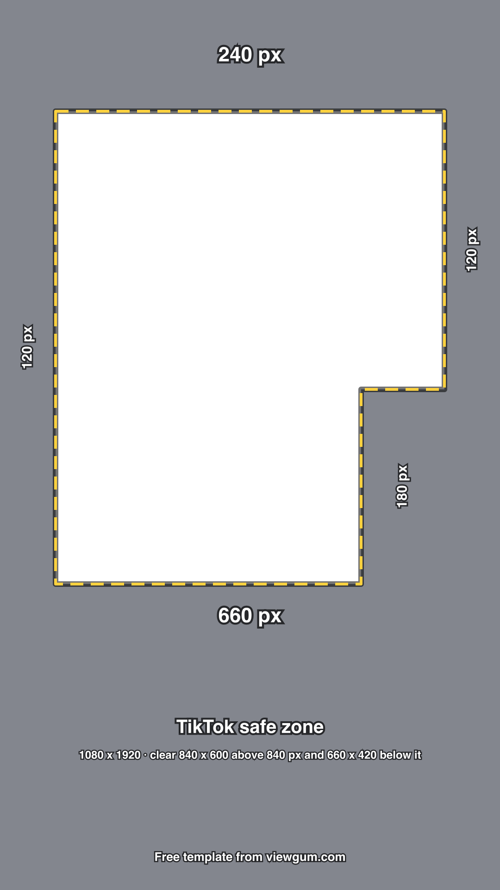

# Short-form video specs: safe zones, length and caption limits

Safe zones for TikTok, YouTube Shorts, Instagram Reels and Facebook Reels in pixels, as JSON, transparent PNG templates, a
JavaScript module and a small command line tool. No dependencies.

On a 1080 x 1920 frame, text that stays at least **288 px from the top, 672 px from the bottom, 120 px from the left and 192 px
from the right, and out of the right 300 px below y = 840** is inside all four apps' published 9:16 safe zones at once.

The apps publish pixel figures only in their 9:16 ad guidance, so these boxes are those presets, not a guarantee: what an app
covers also changes with the placement, the caption's length, the reading direction and the app version. Each entry in
[`data/`](data) names its source (the app's own guidance, a standard or a study) and the day it was read; the all-apps box,
spans and word counts are calculated from them.

## Safe zones at 1080 x 1920

| App | Top | Bottom | Left | Right | Button column | Source |
|---|---|---|---|---|---|---|
| TikTok (In-Feed, standard, left to right) | 240 | 660 | 120 | 120 | from y = 840 down, 300 px from the right edge | [TikTok video ad specifications](https://ads.tiktok.com/help/article/video-ads-specifications) and its In-Feed safe zone file, measured |
| YouTube Shorts | 288 | 672 | 48 | 192 | inside the 192 px right margin | [Google Ads Help: square and vertical video](https://support.google.com/google-ads/answer/9128498?hl=en) |
| Instagram Reels | 269 | 672 | 65 | 65 | not modelled: Meta gives only percentages | [Meta Ads Guide: Instagram Reels](https://www.facebook.com/business/ads-guide/update/video/instagram-reels) (14% top, 35% bottom, 6% sides) |
| Facebook Reels | 269 | 672 | 65 | 65 | not modelled: Meta gives only percentages | [Meta Ads Guide: Facebook Reels](https://www.facebook.com/business/ads-guide/update/video/facebook-facebook-reels) |
| **All four at once** | **288** | **672** | **120** | **192** | **from y = 840 down, 300 px from the right edge** | the largest margin on each side |

The box inside all four is 768 x 552 px above y = 840 and 660 x 408 px below it. A caption centred on the frame can be 696 px wide
above y = 840 (x 192 to 888) and 480 px wide below it (x 300 to 780).

Reels show like, comment and share icons on the lower right. Meta publishes no width for them beyond its 6% side margin, so they
are not modelled here; `check` says so for Reels. Keep text away from them.

## Templates

Transparent PNG overlays at 1080 x 1920. Put one on the top track of your editor, keep every caption, title, face and logo inside
the outline, then hide the track before you export.

| File | What it shows |
|---|---|
| [`templates/tiktok-safe-zone-template-1080x1920.png`](templates/tiktok-safe-zone-template-1080x1920.png) | TikTok: top, bottom, sides and the lower right button column shaded, margins labelled |
| [`templates/youtube-shorts-safe-zone-template-1080x1920.png`](templates/youtube-shorts-safe-zone-template-1080x1920.png) | YouTube Shorts: top band, tall bottom band and right column shaded |
| [`templates/reels-safe-zone-template-1080x1920.png`](templates/reels-safe-zone-template-1080x1920.png) | Instagram and Facebook Reels: 14% top, 35% bottom, 6% sides |
| [`templates/9x16-safe-zone-grid-template-1080x1920.png`](templates/9x16-safe-zone-grid-template-1080x1920.png) | Inside all four at once, with a rule-of-thirds grid and centre lines |

The PNGs label the button column by how far it reaches past the side margin above it: 180 px past TikTok's 120 px, and 108 px
past the 192 px of the all-apps box. Both end at x = 780, 300 px from the right edge.



For another 9:16 size, the CLI and the module draw the same overlay as an SVG at that resolution.

## Command line

Node 18 or newer. Run it straight from GitHub:

```sh
npx github:viewgum/short-form-video-specs margins --size 720x1280
npx github:viewgum/short-form-video-specs check --rect 140,900,600,200 --platform all
npx github:viewgum/short-form-video-specs span --bottom 1248
npx github:viewgum/short-form-video-specs overlay --platform tiktok --size 1080x1920 --grid > tiktok-overlay.svg
npx github:viewgum/short-form-video-specs words --seconds 60
npx github:viewgum/short-form-video-specs limits
```

`check` exits 0 when the box is inside the published safe zone, 1 when it is not and 2 on bad input, so it fits in a render
script. An answer that covers Reels says that Meta's lower-right icons are not modelled, and a frame that is not exactly 9:16
gets a note that the presets were stretched:

```
$ sfspecs check --rect 140,900,700,200
Not inside the published 9:16 ad safe zone for all four apps at once: it reaches the button column (below y 840, right of x 780).
```

## JavaScript

The module has no Node-only imports, so it loads in Node, browsers and bundlers. Install it from GitHub:

```sh
npm install github:viewgum/short-form-video-specs
```

```js
import { safeBox, checkRect, centredSpan, overlaySvg, wordsFor } from "short-form-video-specs";

safeBox("all", { width: 1080, height: 1920 });
// { left: 120, right: 888, top: 288, bottom: 1248, railTop: 840, railLeft: 780 }

checkRect({ x: 140, y: 900, width: 700, height: 200 }, "youtube-shorts").clear; // true
checkRect({ x: 140, y: 900, width: 700, height: 200 }).problems;
// [ "it reaches the button column (below y 840, right of x 780)" ]

centredSpan(1248); // { left: 300, right: 780, width: 480 }: the widest centred caption ending at y 1248
wordsFor(30);      // 75, 91 and 98 words at 150, 183 and 196 words a minute
overlaySvg("tiktok", { width: 720, height: 1280 }, { grid: true }); // an SVG string
```

Types are in [`index.d.ts`](index.d.ts). Platform ids: `tiktok`, `youtube-shorts`, `instagram-reels`, `facebook-reels`, and
`all` for the box inside all four. `safeBox`, `checkRect`, `centredSpan` and `wordsFor` throw a `RangeError` on bad input. Box
values are exact; `overlaySvg` writes coordinates to two decimals, and `round()` is there for display. `checkRect` also returns
`unmodelled`, a note for the apps whose overlays the data does not fully cover. A frame that is not 9:16 gets the presets
stretched to it.

## The data

| File | What it holds |
|---|---|
| [`data/safe-zones.json`](data/safe-zones.json) | Each app's box, margins, clear rectangles and sources; the box inside all four; 16:9 title and action safe from SMPTE ST 2046-1 |
| [`data/length-limits.json`](data/length-limits.json) | How long a post can be, by route: Shorts 3 minutes; TikTok 60 minutes uploaded in the phone app, 30 minutes on the web, 10 minutes recorded in the app or sent through the API; Reels 20 minutes recorded and edited in the app (3 seconds to 15 minutes through the API); Facebook reels no limit in the app (3 to 90 seconds through the Page API) |
| [`data/text-limits.json`](data/text-limits.json) | Title, caption and hashtag limits, with the route each applies to: YouTube title 100 and description 5,000 characters; TikTok and Instagram captions 2,200 through their APIs; Instagram 5 hashtags in the app |
| [`data/speaking-rates.json`](data/speaking-rates.json) | Three measured English speaking rates (150, 183 and 196 words a minute) used as slow, normal and fast presets for script length |

A box is the area an app leaves clear: `left`, `right`, `top`, `bottom`. From `railTop` down, a button column moves the right edge
in to `railLeft`. With no column, `railTop` equals `bottom` and `railLeft` equals `right`. The box inside all four takes the
largest top, bottom and side margins, plus the one button column that steps in below a line (TikTok's).

The JSON files are the source; `npm run build` copies them into `lib/data.mjs` for the module, and `npm test` fails if the two
differ.

## Keeping it current

Each source has a `checked` date. If an app moves its overlays or changes a limit,
[open an issue](../../issues/new?template=figure-changed.yml) with the page and the new figure.

## License

Code (`bin/`, `scripts/`, `index.mjs`, `index.d.ts`, `test.mjs`): MIT. Data (`data/`, `lib/data.mjs`) and images
(`templates/`): CC BY 4.0, credit "ViewGum, viewgum.com". See [LICENSE](LICENSE).

## Maintainer

Maintained by [ViewGum](https://viewgum.com). The same figures run the browser checker at
[viewgum.com/safe-zones](https://viewgum.com/safe-zones), which checks a frame of your own without uploading it.
